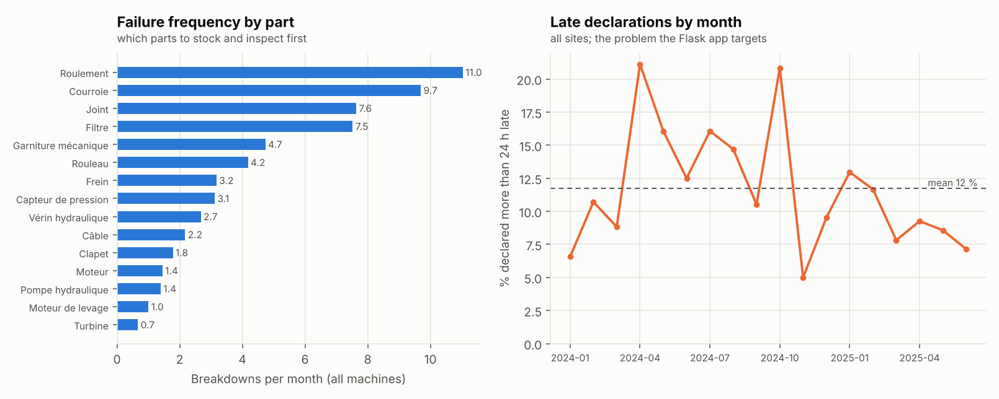
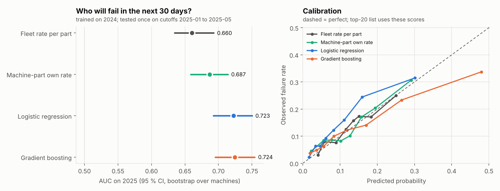

# Results

Auto-generated by `pannes run`. **Synthetic data** reproducing the problems of real site files; no real company data is used.

Setup: 120 machines (5 types x 3 sites), 18 quarterly Excel files, 1,226 rows describing 1,180 true breakdowns.

## Incremental load

| Run | Files loaded | Files skipped | Rows read | Rows loaded | Rows rejected |
|---|---|---|---|---|---|
| 2024 files | 12 | 0 | 826 | 759 | 67 |
| same inbox again | 0 | 12 | 0 | 0 | 0 |
| 2025 files arrive | 6 | 12 | 400 | 358 | 42 |

Rejected rows overall: 109 of 1,226 (8.9 %). By reason: duplicate 46, date_incoherente 22, date_illisible 15, equipement_inconnu 11, champ_manquant 8, date_future 7.

## Cleaning checked against the generator's labels

Clean rows wrongly rejected: 0; defective rows kept: 0.

| Injected defect | Rows | Rejected with the right reason |
|---|---|---|
| champ_manquant | 8 | 8 |
| date_future | 7 | 7 |
| date_illisible | 15 | 15 |
| date_incoherente | 22 | 22 |
| duplicate | 46 | 46 |
| equipement_inconnu | 11 | 11 |

The rules were written for these defect types, so this shows they work as specified, not that they would catch unknown errors.

## Reliability KPIs (SQL views)

- Breakdowns in the database: 1,117
- Mean declaration delay: 18.2 h; declared more than 24 h late: 11.7 %
- MTTR: 6.0 h; mean MTBF per machine: 2,356 h; mean availability: 99.57 % (lowest machine 97.87 %)

| Part | Breakdowns | Per month | MTTR (h) |
|---|---|---|---|
| Roulement | 198 | 11.0 | 6.2 |
| Courroie | 174 | 9.7 | 7.3 |
| Joint | 137 | 7.6 | 6.7 |
| Filtre | 135 | 7.5 | 5.1 |
| Garniture mécanique | 85 | 4.7 | 4.3 |
| Rouleau | 75 | 4.2 | 4.5 |

These views are what a Power BI report would connect to; no Power BI report is built here.

## Predictive maintenance: failure within 30 days

432 machine-parts scored on the 1st of each month. Trained on 10 monthly cutoffs of 2024 (4,320 rows), tested once on 5 cutoffs of 2025 (2,160 rows); 13.5 % of test machine-parts fail within 30 days. Intervals: bootstrap over machines.

| Model | AUC [95 % CI] | AUC gain vs baseline [95 % CI] | PR-AUC | Brier | Top-20/month: hits | Spare parts MAE |
|---|---|---|---|---|---|---|
| Fleet rate per part (baseline) | 0.660 [0.634, 0.693] | baseline | 0.210 | 0.1123 | 23/100 (23 %) | 1.33 |
| Machine-part own rate | 0.687 [0.658, 0.714] | [-0.001, +0.049] | 0.272 | 0.1098 | 39/100 (39 %) | 1.32 |
| Logistic regression | 0.723 [0.693, 0.750] | [+0.025, +0.093] | 0.292 | 0.1095 | 42/100 (42 %) | 1.71 |
| Gradient boosting | 0.724 [0.695, 0.754] | [+0.035, +0.092] | 0.309 | 0.1096 | 41/100 (41 %) | 1.46 |

Most useful signals (drop in AUC when shuffled, gradient boosting): taux_piece_flotte 0.117, jours_depuis_derniere 0.061, n_machine_365 0.050, age_machine 0.016.

